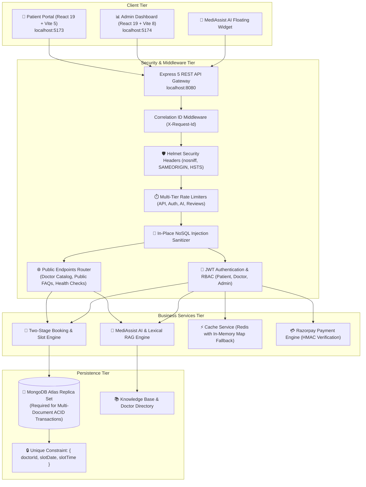
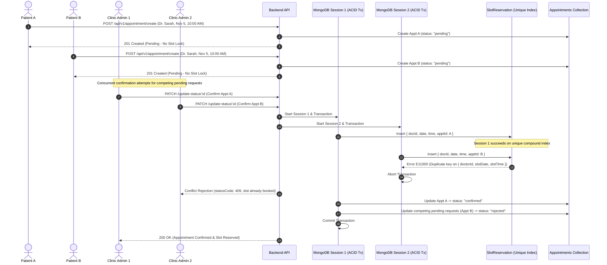
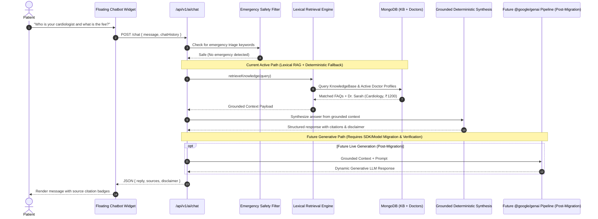
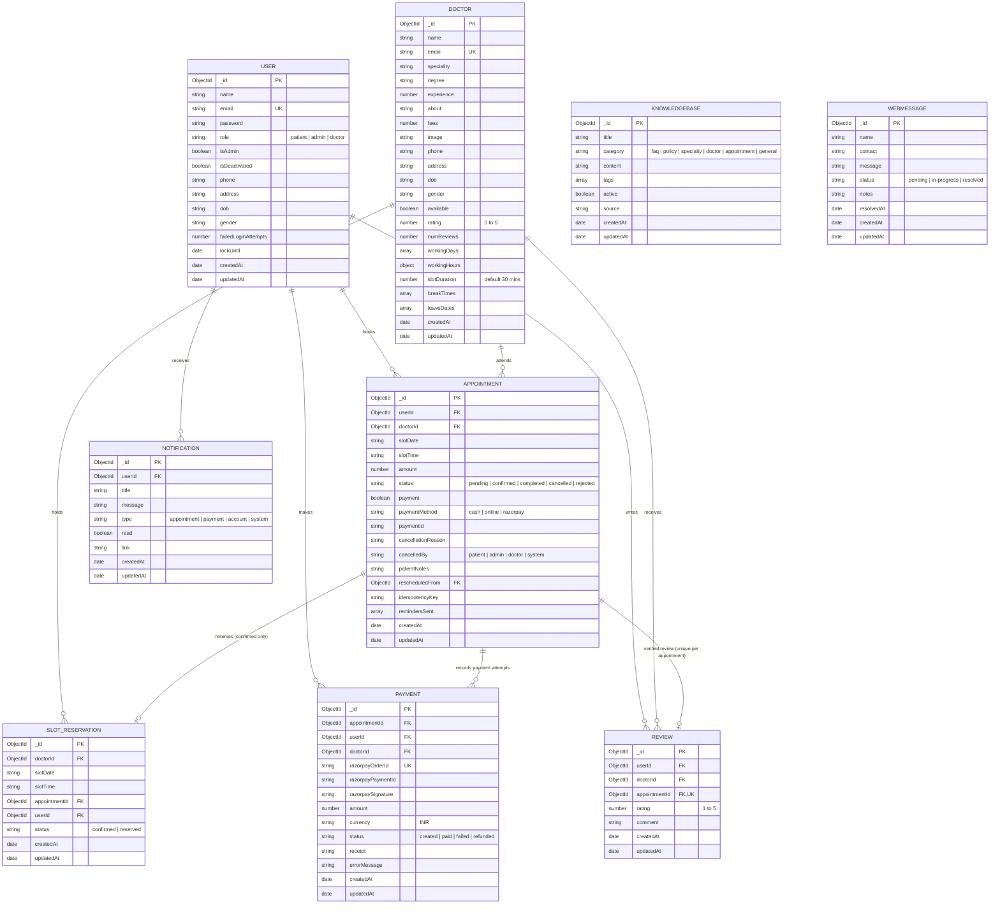

# 🏥 MediCare (DAP) — Doctor Appointment & Healthcare Management System

[](https://nodejs.org/)
[](https://expressjs.com/)
[](https://react.dev/)
[](https://vitejs.dev/)
[](https://www.mongodb.com/)
[](http://localhost:8080/api-docs)
[](./DOC-Appointment-Mern/tests)

> A full-stack healthcare platform engineered with the **MERN stack**, featuring a **Two-Stage Atomic Concurrency-Protected Appointment Reservation System**, a **Lexical RAG-Powered AI Healthcare Assistant (MediAssist AI)**, **Verified Patient Reviews & Ratings**, a **Clinical Executive Admin Dashboard**, and a **Prepared Razorpay Payment Gateway Pipeline (Configured for Future Activation)**.

---

## 🌟 Table of Contents
- [Project Overview](#-project-overview)
- [Key Highlights](#-key-highlights)
- [User Roles](#-user-roles)
- [System Architecture](#-system-architecture)
- [Key Features](#-key-features)
- [Two-Stage Appointment Reservation Architecture](#-two-stage-appointment-reservation-architecture)
- [MediAssist AI & RAG Pipeline](#-mediassist-ai--rag-pipeline)
- [Payment Gateway Architecture (Partially Implemented)](#-payment-gateway-architecture-partially-implemented)
- [Database Design & ER Diagram](#-database-design--er-diagram)
- [Verified Technology Stack](#-verified-technology-stack)
- [Repository Folder Structure](#-repository-folder-structure)
- [Prerequisites & Installation](#-prerequisites--installation)
- [Environment Configuration](#-environment-configuration)
- [Running the Application](#-running-the-application)
- [Automated Testing & Build Verification](#-automated-testing--build-verification)
- [Security & Reliability](#-security--reliability)
- [Complete API Documentation](#-complete-api-documentation)
- [Known Limitations & Future Improvements](#-known-limitations--future-improvements)
- [License](#-license)

---

## 📖 Project Overview

MediCare (Doctor Appointment Platform — DAP) provides an outpatient management and consultation booking solution built to resolve real-world clinical operations issues:

1. **Elimination of Double-Bookings:** Traditional clinic scheduling systems lock time slots prematurely during browsing or suffer from race conditions when two patients or staff members confirm the same slot at the same time. MediCare implements a **Two-Stage Booking Workflow** protected by MongoDB multi-document ACID transactions and unique compound index constraints.
2. **Clinical Triage & Patient Guidance:** Patients frequently need guidance on clinic schedules, doctor specialties, consultation charges, and outpatient protocols. MediCare integrates **MediAssist AI**, combining keyword-scored lexical RAG retrieval over active clinic handbook articles with safety guardrails that detect emergency symptoms.
3. **Verified Clinical Feedback:** Doctor rating scores are calculated strictly from consultations marked completed in the database. Patients can rate a doctor only once per verified appointment, preventing review spam.
4. **Administrative Oversight:** A dedicated React 19 / Vite 8 administrative panel gives clinic administrators and doctors tools to review incoming booking requests, manage working hours and breaks, administer knowledge base articles, and track patient communications.

---

## ⚡ Key Highlights

- **Multi-Document ACID Transactions:** Stage 2 authorized appointment confirmations execute within atomic MongoDB transaction sessions, guaranteeing that slot reservation creation, status updating, and competing request rejections succeed or fail as an indivisible unit.
- **Database-Enforced Duplicate Reservation Prevention:** Enforced at the database engine level via unique compound indexes on `{ doctorId, slotDate, slotTime }` across both reservations and confirmed appointments.
- **Decoupled Architecture:** Express 5 REST API gateway servicing two independent React 19 single-page applications: the Patient Portal (Vite 5) and the Executive Admin Panel (Vite 8).
- **Multi-Tier Security & Defense-in-Depth:** In-place NoSQL operator sanitization, rate-limiting tiering (auth, public, bookings, AI, reviews), salted bcrypt password hashing, IDOR ownership checks, and correlation IDs (`X-Request-Id`).
- **Resilient Distributed Caching:** Two-layer caching architecture utilizing Redis (`ioredis`) with an automatic, graceful fallback to a local in-memory `Map` cache with TTL expiration.
- **Comprehensive Test Coverage:** 70 automated tests across 12 test suites executed natively via Node.js test runner (`node --test`), verifying transaction invariants, scheduling math, cache invalidation, and authentication contracts.

---

## 👥 User Roles

| Role | Access Level | Responsibilities & Capabilities |
| :--- | :--- | :--- |
| **Patient** | Authenticated (`userAuth`) | Discovers doctors, inspects fees and verified ratings, submits pending appointment requests, reschedules or cancels appointments, chats with MediAssist AI, and submits reviews for completed visits. |
| **Doctor** | Authenticated (`isAdminOrDoctor`) | Reviews appointments assigned to their profile, confirms pending requests within their schedule, and inspects verified patient reviews. |
| **Clinic Administrator** | Authenticated (`isAdmin`) | Full clinical oversight: reviews and approves/rejects all pending appointment requests, manages doctor schedules and break times, updates the clinic knowledge base, oversees patient profiles, and responds to contact inquiries. |

---

## 🏗️ System Architecture



---

## ✨ Key Features

### 🏥 Patient Portal (`DOC-Appointment-Mern/client`)
- **Doctor Catalog & Filtering:** Filter doctors by clinical specialty (General Physician, Cardiologist, Dermatologist, Pediatrician, Neurologist, Orthopedic, etc.), search by doctor name, and sort by experience, fees, or ratings.
- **Dynamic Slot Availability:** Dynamic on-demand calculation of available consultation slots based on doctor working hours (e.g. 09:00–17:00), customizable slot duration (default 30 mins), excluded break times (e.g. 13:00–14:00), approved leave dates, and existing confirmed reservations.
- **Two-Stage Booking Workflow:** Patients submit booking requests that start in `pending` status without prematurely locking the slot.
- **Appointment Management:** Comprehensive dashboard to inspect booking status (`Pending`, `Confirmed`, `Completed`, `Cancelled`, `Rejected`), download appointment slips, cancel pending or confirmed visits, and reschedule to alternate open dates.
- **Verified Reviews & Star Ratings:** Patients can submit written reviews and 1-to-5 star ratings for consultations marked `completed`. Unique index ensures exactly one review per appointment.
- **In-App Notifications:** Notification records for booking confirmation, request rejections, cancellations, and status updates.
- **MediAssist AI Floating Chatbot:** Always-accessible conversational assistant with lexical RAG search across clinic guidelines and immediate emergency safety redirection.
- **Payment Gateway UI:** Pre-flight status check and payment button for confirmed appointments, detecting unconfigured gateway credentials and directing patients to settle consultation fees at the clinic reception.

### 📊 Executive Admin Panel (`admin-panel`)
- **Executive KPI Dashboard:** Aggregated summary metrics for total appointments, confirmed appointments, pending requests, active doctors, registered patients, and resolved inquiries.
- **Doctor Schedule Management:** Create and update doctor profiles, upload photo avatars, configure consultation fees, experience, medical degrees, working days, working hours, break periods, slot durations, and toggle active availability.
- **Two-Stage Request Processing:** Dedicated queue to review incoming pending booking requests, identify competing requests for identical slots, confirm selected bookings, or reject requests with audit reasons.
- **Patient Directory:** Search and browse registered patient accounts, view demographic information, and inspect patient appointment histories.
- **Knowledge Base Management:** Author, edit, categorize, and deactivate clinic handbook articles, FAQs, and specialty guidelines indexed by the MediAssist AI retrieval pipeline.
- **Contact & Inquiry Inbox:** Manage patient web messages, update resolution statuses (`pending`, `in-progress`, `resolved`), and log administrative resolution notes.

---

## 📅 Two-Stage Appointment Reservation Architecture

MediCare separates appointment booking into two stages to eliminate slot starvation and race conditions:

```
[Patient Request] -> Stage 1: PENDING (No Reservation Document)
                            |
                     (Admin Review)
                            |
                            v
[Admin Approval]  -> Stage 2: CONFIRMED (ACID Tx -> Unique Slot Reservation Inserted)
                            |
                 +----------+----------+
                 |                     |
                 v                     v
   [Competing Requests Auto-Rejected]  [Concurrent Admin Confirmations Collide: 409 Conflict]
```

### Stage 1: Appointment Request (No Slot Lock)
1. A patient selects an active doctor, appointment date, and available time slot.
2. An appointment document is created in the database with `status: "pending"`.
3. **No document is inserted into [`SlotReservationModel`](./DOC-Appointment-Mern/models/slotReservationModel.js) at this stage.** The time slot remains open for other patients to browse and request.
4. Multiple patients can submit pending requests for the same doctor, date, and slot without conflicting.

### Stage 2: Authorized Confirmation (Atomic Slot Lock)
1. An administrator or authorized doctor reviews pending requests.
2. Approving a request triggers a **MongoDB Multi-Document ACID Transaction**:
   - Queries `SlotReservationModel` to verify the slot `{ doctorId, slotDate, slotTimeNormalized }` has not already been reserved.
   - Attempts an atomic document creation in [`SlotReservationModel`](./DOC-Appointment-Mern/models/slotReservationModel.js).
   - The unique compound index `{ doctorId: 1, slotDate: 1, slotTime: 1 }` guarantees that **at most one reservation can exist for a given doctor, date, and time slot**.
   - Upon successful insertion, the appointment status transitions from `pending` to `confirmed`.
   - **Competing Request Rejection:** All other pending appointments for that identical doctor, date, and time slot are automatically updated to `status: "rejected"` with the system cancellation reason: `"This slot was confirmed for another patient"`.
   - **Concurrent Conflict Resolution:** If two administrators attempt to confirm competing requests for the same slot simultaneously, MongoDB's unique compound index triggers a duplicate key collision (`E11000`) on the second insert attempt. The transaction aborts, and the controller catches this error and returns a slot conflict error (`statusCode: 409`), rejecting the losing confirmation while the winning confirmation retains the reservation. *(Note: This concurrency invariant is verified via database-level transaction tests; no live network-level HTTP integration tests have been performed).*

### Reservation Lifecycle & Slot Release (Cancellation vs Rejection)
- **Cancelling a Confirmed Appointment:** When a patient or administrator cancels an appointment that is currently `confirmed`, the system atomically deletes the associated reservation document from [`SlotReservationModel`](./DOC-Appointment-Mern/models/slotReservationModel.js) (`deleteOne({ appointmentId })`), releasing the slot back to the clinic's availability pool for future bookings.
- **Rejecting a Pending Appointment:** When an administrator rejects a `pending` request (or when competing pending requests are auto-rejected upon another request's confirmation), **no reservation is deleted or released** because pending requests never created or held a reservation document in `SlotReservationModel` during Stage 1. Only confirmed appointments ever hold a slot reservation.
- **Atomic Rescheduling:** Validates target slot availability before transferring the reservation, ensuring the original reservation is not released if the target slot is unavailable.

### Concurrency Sequence Diagram



---

## 🧠 MediAssist AI & RAG Pipeline

MediAssist AI is an intelligent healthcare assistant integrated into the patient portal to provide grounded guidance on clinic services, doctor specialties, consultation fees, and appointment procedures.

### Current Implementation & Operational Status
The AI subsystem consists of functional layers with distinct operational statuses:

1. **Lexical Retrieval Engine (Active & Verified):**
   - Queries active [`KnowledgeBaseModel`](./DOC-Appointment-Mern/models/knowledgeBaseModel.js) documents and available [`DoctorModel`](./DOC-Appointment-Mern/models/doctorModel.js) profiles.
   - Tokenizes the query, filters common stop words, and calculates weighted relevance scores across article titles (weight: 5), tags (weight: 4), body content (weight: 1), and doctor specialties.
2. **Clinical Safety Interception (Active & Verified):**
   - Detects critical medical emergency keywords (`"chest pain"`, `"suicide"`, `"heart attack"`, `"can't breathe"`, `"severe bleeding"`, `"stroke"`, `"overdose"`).
   - Executes **prior to retrieval and LLM processing**, immediately returning an emergency triage alert with non-diagnostic safety disclaimers.
   - **Emergency Number Guidance & Source-Code Status:**
     - **Primary Standard (India):** **112** is India's official unified National Emergency Response Support System (ERSS) helpline covering medical, police, and fire emergencies nationwide.
     - **Current Implementation Disclosure:** The backend implementation in [`aiService.js`](./DOC-Appointment-Mern/services/aiService.js) currently outputs a hardcoded string referencing `"112 / 108 / 911"` (retaining the legacy state ambulance helpline `108` and US-specific `911`).
     - **Required Source-Code Correction (Future Work):** Standardizing the emergency response string in `aiService.js` to strictly prioritize India's unified helpline **112** (and removing non-applicable regional numbers like 911) is an identified required correction for future work. The current codebase has not been modified and continues to output `"112 / 108 / 911"`.
3. **Deterministic Fallback Engine (Active & Verified):**
   - Constructs a structured response directly from retrieved knowledge base articles and doctor directory entries without throwing unhandled exceptions.
4. **Google Gemini LLM Integration (Legacy Integration / Future Migration Path):**
   - The current codebase references the legacy `@google/generative-ai` (`^0.24.1`) SDK and the `gemini-1.5-flash` model.
   - **Important Status:** Live generative AI is not operational merely by configuring `GEMINI_API_KEY`. Google has retired/deprecated older Gemini SDK interfaces in favor of the unified Google GenAI SDK (`@google/genai`). Live generative synthesis represents a future path requiring migration to `@google/genai` with a supported model and verification. In the current implementation, all queries are fulfilled via the active lexical retrieval and deterministic fallback engine.



---

## 💳 Payment Gateway Architecture (Partially Implemented)

> **Current Implementation Status: PARTIALLY IMPLEMENTED — FUTURE INTEGRATION**

The application includes an engineered backend payment pipeline, database models, and frontend integration code, prepared for activation when online payments are desired.

### Implemented & Verified Components
- **Database Model & Payment Persistence:** [`PaymentModel`](./DOC-Appointment-Mern/models/paymentModel.js) persists transactions with indexed fields for `appointmentId`, `userId`, `razorpayOrderId`, `razorpayPaymentId`, `amount`, `currency`, `receipt`, and `status`.
- **Order Creation API:** `POST /api/v1/payment/create-order` validates the appointment, checks user ownership, ensures it is `confirmed`, calculates authoritative fees from `doctor.fees` in paise, and prevents duplicate orders by reusing active created orders.
- **Cryptographic Signature Verification:** `POST /api/v1/payment/verify` cryptographically verifies the payment signature using HMAC-SHA256 (`crypto.createHmac("sha256", secret).update(`${orderId}|${paymentId}`).digest("hex")`).
- **Payment Persistence & Idempotency:** Upon successful verification, the payment record is persisted as `status: "paid"`. Subsequent duplicate verification calls safely return the existing payment record without creating duplicate ledger entries.
- **Client Failure Handling:** `POST /api/v1/payment/record-failure` captures client checkout dismissals or payment failures, persisting a `failed` payment record with error details for diagnostic auditability.
- **Strict Separation of Concerns:**
  - Payment processing is strictly decoupled from appointment status transitions and slot reservations.
  - Payment verification updates payment records (`payment: true` on the appointment and `status: "paid"` on the payment document), but **never** modifies the appointment's status (appointments must already be `confirmed` before payment is permitted).
  - Payment processing never creates, modifies, or releases slot reservations in `SlotReservationModel`. Slot reservations remain exclusively managed by the two-stage booking and cancellation lifecycle.
- **Frontend SDK Script:** Razorpay Checkout SDK (`https://checkout.razorpay.com/v1/checkout.js`) is loaded in [`index.html`](./DOC-Appointment-Mern/client/index.html).
- **Payment Button Guard:** The Pay button in [`MyAppointments.jsx`](./DOC-Appointment-Mern/client/src/pages/User/MyAppointments.jsx) strictly requires `!appt.payment && appt.status === "confirmed"`. Pending, cancelled, or rejected appointments never display the Pay button.

### Current Operating State
Online checkout is currently unconfigured because API credentials (`RAZORPAY_KEY_ID`, `RAZORPAY_KEY_SECRET`) are not provisioned in the backend environment. When a patient clicks the Pay button, the pre-flight check `GET /api/v1/payment/status` detects that gateway credentials are missing, and the user interface displays the informational notice:
> *"Online payment gateway is in test mode. You can settle consultation fees at the clinic reception."*

Consultation fees are collected directly at the clinic reception desk upon arrival. Online payments have not been enabled or verified in test mode against live payment networks.

### Steps Required for Future Activation
Online payment will not become fully operational merely by adding API keys. The following steps are required:
1. **API Keys:** Register and obtain keys from the [Razorpay Dashboard](https://dashboard.razorpay.com/). Set `RAZORPAY_KEY_ID` and `RAZORPAY_KEY_SECRET` in `DOC-Appointment-Mern/.env`.
2. **Merchant Verification & KYC:** Complete business verification and activate payment methods (Cards, UPI, Netbanking).
3. **Webhooks Implementation:** Implement and configure server-side webhooks (`payment.captured`, `payment.failed`) with secret verification to handle asynchronous network drops and user tab closures.
4. **End-to-End Testing:** Conduct complete test-mode transactions using Razorpay mock cards and UPI IDs to verify live HMAC signature verification, payment record persistence, idempotency, and failure recording under active network conditions.

---

## 🗄️ Database Design & ER Diagram



### Key Database Indexes & Constraints
- `slot_reservations`: **Unique Compound Index** on `{ doctorId: 1, slotDate: 1, slotTime: 1 }`. Guarantees at most one active reservation document per slot at the database engine level. **Note:** Pending appointments do not hold a reservation (`APPOINTMENT ||--o| SLOT_RESERVATION`).
- `appointments`:
  - Unique Partial Compound Index on `{ doctorId: 1, slotDate: 1, slotTime: 1 }` with `partialFilterExpression: { status: "confirmed" }`. Prevents multiple confirmed appointments for identical slots.
  - Compound query indexes on `{ userId: 1, createdAt: -1 }`, `{ doctorId: 1, slotDate: 1 }`, `{ status: 1, createdAt: -1 }`, and `{ slotDate: 1, status: 1 }`.
  - Single-field index on `{ idempotencyKey: 1 }`.
- `doctors`: Single-field indexes on `{ name: 1 }`, `{ fees: 1 }`, `{ experience: -1 }`, `{ rating: -1 }`, compound index on `{ speciality: 1, available: 1 }`, and unique index on `{ email: 1 }`.
- `users`: Unique index on `{ email: 1 }` and single-field query indexes on `{ role: 1 }` and `{ isAdmin: 1 }`.
- `reviews`: Unique index on `{ appointmentId: 1 }` (strictly enforces maximum 1 review per completed visit) and compound index on `{ doctorId: 1, createdAt: -1 }`.
- `payments`: Unique index on `{ razorpayOrderId: 1 }` and query indexes on `{ appointmentId: 1 }`, `{ userId: 1 }`, and `{ status: 1 }`. Multiple payment attempts may be associated with an appointment (`APPOINTMENT ||--o{ PAYMENT`).
- `knowledgebase`: Text index on `{ title: "text", content: "text", tags: "text" }` and compound index on `{ category: 1, active: 1 }`.
- `notifications`: Compound index on `{ userId: 1, read: 1, createdAt: -1 }`.
- `webmessages`: Compound index on `{ status: 1, createdAt: -1 }`.

---

## 🛠️ Verified Technology Stack

### Host Runtime Environment
- **Node.js:** `^20.19.0 || >=22.12.0` (Active/Maintenance LTS).
  *Note: Node.js is the host runtime environment; its minimum version is mandated by the Admin Panel's Vite 8 engine constraints. It is not an npm package dependency resolved or pinned by `package-lock.json`.*

### Verified Package Dependencies

| Tier / Role | Package | Declared Version Range (`package.json`) | Resolved Version (`package-lock.json`) | Purpose in MediCare |
| :--- | :--- | :--- | :--- | :--- |
| **Backend Framework** | `express` | `^5.1.0` | `5.2.1` | Core REST API Gateway with native async error handling |
| **Database ODM** | `mongoose` | `^9.9.3` | `9.9.3` | Schema definition, validation, and transaction sessions |
| **Authentication** | `jsonwebtoken` | `^9.0.3` | `9.0.3` | Signed stateless JWT token generation and verification |
| **Password Hashing** | `bcryptjs` | `^3.0.3` | `3.0.3` | Salted password hashing prior to at-rest storage |
| **Security Headers** | `helmet` | `^8.3.0` | `8.3.0` | Secure HTTP response headers (CSP disabled for Swagger) |
| **Rate Limiting** | `express-rate-limit` | `^8.7.2` | `8.7.2` | Multi-tier endpoint abuse and brute-force protection |
| **Distributed Cache** | `ioredis` | `^6.0.0` | `6.0.0` | Redis caching client with in-memory map fallback |
| **Artificial Intelligence** | `@google/generative-ai` | `^0.24.1` | `0.24.1` | Legacy Gemini client (active fallback to lexical RAG) |
| **Payment Gateway** | `razorpay` | `^2.9.8` | `2.9.8` | Order creation and cryptographic HMAC verification SDK |
| **File Uploads** | `multer` | `^2.2.0` | `2.2.0` | Memory buffer storage with strict image MIME filtering |
| **API Documentation** | `swagger-ui-express` | `^5.0.1` | `5.0.1` | Interactive OpenAPI 3.0 specification UI at `/api-docs` |
| **Swagger JSDoc** | `swagger-jsdoc` | `^6.3.0` | `6.3.0` | JSDoc annotation parser for Swagger spec generation |
| **Response Compression** | `compression` | `^1.8.2` | `1.8.2` | Gzip response compression middleware |
| **HTTP Request Logger** | `morgan` | `^1.11.0` | `1.11.0` | HTTP request logging formatted with correlation IDs |
| **Patient Frontend** | `react` / `react-dom` | `^19.1.0` | `19.1.0` | Single-page application UI with concurrent rendering |
| **Patient Build Tool** | `vite` | `^5.4.10` | `5.4.21` | High-speed frontend development server and bundler |
| **Admin Frontend** | `react` / `react-dom` | `^19.2.8` | `19.2.8` | Administrative executive dashboard UI |
| **Admin Build Tool** | `vite` | `^8.2.0` | `8.2.2` | Modern Vite 8 frontend build pipeline |
| **State Management** | `@reduxjs/toolkit` | `^2.12.0` | `2.12.0` | Predictable centralized state container |
| **React Redux** | `react-redux` | `^9.3.0` | `9.3.0` | Official React bindings for Redux |
| **Client Routing** | `react-router-dom` | `^7.17.0` (Client) / `^7.18.2` (Admin) | `7.17.0` / `7.18.2` | Declarative client-side routing with route guards |
| **Icons & Notifications** | `lucide-react` / `react-hot-toast` | `^1.65.0` / `^2.6.0` | `1.65.0` / `2.6.0` | SVG iconography and animated toast notifications |

---

## 📁 Repository Folder Structure

```text
DAP/
├── DOC-Appointment-Mern/                # Express 5 REST API Backend
│   ├── config/                          # Configuration modules
│   │   ├── db.js                        # MongoDB Atlas connection & pooling options
│   │   ├── seed.js                      # Database seeder (doctors, users, knowledge)
│   │   ├── specialties.js               # Approved doctor specialty classifications
│   │   └── swagger.js                   # OpenAPI 3.0 specification definition
│   ├── controllers/                     # Request handling & business logic
│   │   ├── aiController.js              # MediAssist AI chat and knowledge endpoints
│   │   ├── appointmentsController.js    # Two-stage booking, transactions, cancellations
│   │   ├── doctorController.js          # Doctor discovery, CRUD, scheduling filters
│   │   ├── notificationController.js    # In-app notifications
│   │   ├── paymentController.js         # Razorpay orders and HMAC verification
│   │   ├── reviewController.js          # Verified patient reviews and rating math
│   │   ├── userController.js            # Registration, login, password resets
│   │   └── webmessageController.js      # Contact inquiry processing
│   ├── middlewares/                     # Express middleware pipeline
│   │   ├── authMiddlewares.js           # JWT authentication, isAdmin, isAdminOrDoctor
│   │   ├── correlationId.js             # X-Request-Id correlation tracking
│   │   ├── errorHandler.js              # Centralized JSON error response handler
│   │   ├── multer.js                    # In-memory image file upload filter
│   │   ├── rateLimiter.js               # Multi-tiered express-rate-limit instances
│   │   └── sanitize.js                  # In-place NoSQL operator sanitizer
│   ├── models/                          # Mongoose database schemas & models
│   │   ├── appointmentsModel.js         # Appointment schema & unique partial index
│   │   ├── doctorModel.js               # Doctor schema & schedule configuration
│   │   ├── knowledgeBaseModel.js        # Clinic guidelines & FAQs for RAG
│   │   ├── notificationModel.js         # In-app patient notifications
│   │   ├── paymentModel.js              # Razorpay transaction ledger
│   │   ├── reviewModel.js               # Verified doctor reviews & ratings
│   │   ├── slotReservationModel.js      # Unique compound slot reservation model
│   │   ├── userModel.js                 # User accounts & toJSON password sanitizer
│   │   └── webMessage.js                # Contact form messages
│   ├── routes/                          # Express route definitions
│   │   ├── aiRoutes.js                  # /api/v1/ai
│   │   ├── appointmentRoutes.js         # /api/v1/appointment
│   │   ├── doctorRoutes.js              # /api/v1/doctor
│   │   ├── notificationRoutes.js        # /api/v1/notification
│   │   ├── paymentRoutes.js             # /api/v1/payment
│   │   ├── reviewRoutes.js              # /api/v1/review
│   │   ├── userRoutes.js                # /api/v1/user
│   │   └── webMessageRoutes.js          # /api/v1/webmessage
│   ├── scripts/                         # Automation & setup utilities
│   │   └── bootstrapAdmin.js            # Script to provision/upgrade an administrator
│   ├── services/                        # Business domain services
│   │   ├── aiService.js                 # Lexical RAG & emergency safety filter
│   │   ├── cacheService.js              # Redis client & in-memory Map fallback
│   │   ├── notificationService.js       # Asynchronous notification dispatcher
│   │   ├── paymentService.js            # Razorpay SDK client & HMAC verifier
│   │   └── schedulingService.js         # Slot calculation & time normalization
│   ├── tests/                           # 12 Automated Node.js test suites (70 tests)
│   ├── client/                          # Patient Portal Frontend (React 19 + Vite 5)
│   │   ├── src/
│   │   │   ├── Api/API.jsx              # Axios instance with auth interceptor
│   │   │   ├── components/              # Layout, Navbar, AI Widget, Doctor Cards
│   │   │   ├── pages/                   # Home, Doctors, Appointments, Profile
│   │   │   └── redux/                   # Redux Toolkit auth slice & store
│   │   ├── package.json                 # Client dependencies
│   │   └── vite.config.js               # Vite 5 configuration
│   ├── .env.example                     # Backend environment configuration template
│   ├── package.json                     # Backend dependencies & test scripts
│   └── server.js                        # Express backend entry point
├── admin-panel/                         # Executive Admin Panel (React 19 + Vite 8)
│   ├── src/
│   │   ├── Api/API.jsx                  # Axios client for admin APIs
│   │   ├── components/                  # Admin Layout, Navigation, Modals
│   │   ├── pages/                       # Dashboard, Doctors, Appointments, Users
│   │   └── redux/                       # Admin auth state & store
│   ├── .env.example                     # Admin panel environment template
│   ├── package.json                     # Admin panel dependencies
│   └── vite.config.js                   # Vite 8 configuration
└── README.md                            # Comprehensive system documentation
```

---

## ⚡ Prerequisites & Installation

### Prerequisites
- **Node.js:** `^20.19.0 || >=22.12.0` (Active/Maintenance LTS; mandated by the Admin Panel's Vite 8 engine constraints)
- **npm:** `v10.0.0` or higher
- **MongoDB:** MongoDB Atlas replica set (required for multi-document ACID transactions; transactions are not supported on standalone MongoDB instances) or a local replica set
- **Redis (Optional):** Local or cloud Redis instance (the system automatically falls back to built-in in-memory caching if omitted)

### 1. Clone the Repository
```bash
git clone https://github.com/anjali9555/doctor-appointment-system.git
cd doctor-appointment-system
```

### 2. Configure Environment Files
Set up environment variables using the provided templates:
```bash
# Backend configuration
cp DOC-Appointment-Mern/.env.example DOC-Appointment-Mern/.env

# Patient Portal configuration
cp DOC-Appointment-Mern/client/.env.example DOC-Appointment-Mern/client/.env

# Admin Panel configuration
cp admin-panel/.env.example admin-panel/.env
```
*(On Windows PowerShell, use `Copy-Item DOC-Appointment-Mern/.env.example DOC-Appointment-Mern/.env`, etc.)*

### 3. Install Dependencies
```bash
# 1. Install Backend Dependencies
cd DOC-Appointment-Mern
npm install

# 2. Install Patient Portal Dependencies
cd client
npm install

# 3. Install Admin Panel Dependencies
cd ../../admin-panel
npm install
```

---

## ⚙️ Environment Configuration

### Backend (`DOC-Appointment-Mern/.env`)
```ini
# Server Configuration
PORT=8080
NODE_ENV=development

# Database (MongoDB Atlas Replica Set connection string required for transactions)
MONGO_URL=mongodb+srv://<username>:<password>@cluster.mongodb.net/doc-appointment?retryWrites=true&w=majority

# Authentication & Security
JWT_SECRET=your_super_secret_jwt_key_change_in_production_min32chars
ADMIN_SECRET=your_secure_admin_provision_passcode_min32chars
ADMIN_EMAIL=admin@yourclinic.com
ADMIN_PASSWORD=your_strong_admin_password_min12chars

# Client Allowlist (CORS)
CLIENT_URL=http://localhost:5173
ADMIN_URL=http://localhost:5174

# High-Performance Caching (Optional: falls back to in-memory cache if omitted)
REDIS_URL=redis://localhost:6379

# MediAssist AI (Legacy integration; active fallback to lexical RAG)
GEMINI_API_KEY=
GEMINI_MODEL=gemini-1.5-flash

# Online Payment Gateway (Razorpay - Future Integration)
RAZORPAY_KEY_ID=
RAZORPAY_KEY_SECRET=
RAZORPAY_MODE=test
```

### Patient Portal (`DOC-Appointment-Mern/client/.env`)
```ini
VITE_BASEURL=http://localhost:8080/api/v1
```

### Admin Panel (`admin-panel/.env`)
```ini
VITE_BASEURL=http://localhost:8080/api/v1
```

---

## 🚀 Running the Application

### 1. Bootstrap an Administrator Account
Before accessing the Admin Panel, provision the initial administrator user using the provided bootstrap utility:
```bash
cd DOC-Appointment-Mern
npm run bootstrap:admin
```
*(This script reads `ADMIN_EMAIL` and `ADMIN_PASSWORD` from `.env` and provisions or synchronizes an administrator account with `isAdmin: true` and `role: "admin"`).*

### 2. Start the Backend API Server
```bash
cd DOC-Appointment-Mern
npm start
```
- API Gateway running at: `http://localhost:8080`
- Swagger OpenAPI Docs: `http://localhost:8080/api-docs`
- Health check: `http://localhost:8080/api/health`

### 3. Start the Patient Portal
```bash
cd DOC-Appointment-Mern/client
npm run dev
```
- Patient Portal running at: `http://localhost:5173`

### 4. Start the Admin Dashboard
```bash
cd admin-panel
npm run dev
```
- Admin Panel running at: `http://localhost:5174`

---

## 🧪 Automated Testing & Build Verification

The backend utilizes Node.js's native test runner (`node --test`), providing test execution without external testing dependencies.

```bash
cd DOC-Appointment-Mern
npm test
```

### Verified Test Suite Results (70 Tests / 12 Suites / 100% Passing)
```text
TAP version 13
✔ 🤖 AI Safety & Payment Gateway Tests (2 tests)
✔ 🏥 Appointment Lifecycle & Concurrency Business Logic (3 tests)
✔ 🔐 Authentication & Security Unit Tests (4 tests)
✔ 🛡️ Security & Role Enforcement Contract Tests (5 tests)
✔ ⚡ Redis & In-Memory Cache Service Tests (5 tests)
✔ 🔒 Slot Lock Manager & Race Condition Invariant Tests (5 tests)
✔ 🖼️ Multer Image Handling & File Filter Tests (6 tests)
✔ 🔄 High-Concurrency Load Simulation Tests (5 tests)
✔ 💳 Razorpay Test-Logic & Cryptographic Verification Unit Tests (10 tests)
✔ 🏥 Doctor Specialties & Rating/Review System Tests (12 tests)
✔ 📅 Scheduling & Dynamic Availability Tests (3 tests)
✔ 🧪 MediCare Slot Reservation & High Concurrency Test Suite (10 tests)

# tests 70
# suites 12
# pass 70
# fail 0
# cancelled 0
# skipped 0
# duration_ms 18392.6661
```

> **Testing Scope Notes:**
> - **Razorpay Test Suites:** Execute local unit and cryptographic HMAC mock signature tests; they do not trigger live financial transactions or contact external bank networks.
> - **Concurrency & Race Condition Suites:** Direct database-level transaction tests and controller function tests (`slot_reservation_concurrency.test.js`, `load_concurrency.test.js`) verify that simultaneous confirmation attempts allow exactly one booking while losing confirmations are rejected due to slot conflicts (`statusCode: 409`). They verify database invariants and controller error handling directly, rather than asserting full network-level HTTP integration responses over active sockets.

### Production Build Verification
- **Patient Frontend (`DOC-Appointment-Mern/client`):** `vite build` transforms 2,263 modules and generates production chunks in `4.26s` with zero errors.
- **Admin Panel (`admin-panel`):** `vite build` transforms 2,126 modules and generates production chunks in `313ms` with zero errors.

---

## 🛡️ Security & Reliability

| Security Layer | Implementation Details |
| :--- | :--- |
| **Password Storage & Transmission** | Passwords are salted and hashed using bcrypt (rounds: 10) prior to database persistence. Passwords in transit must be protected via TLS/HTTPS transport encryption; bcrypt protects at-rest storage only. |
| **Response Sanitization** | `userModel.js` overrides `toJSON()` to delete `password`, `resetPasswordToken`, `resetPasswordExpires`, `failedLoginAttempts`, and `lockUntil` from all serialized output. |
| **NoSQL Operator Sanitizer** | Custom Express 5 in-place sanitizer strips leading `$` and `.` characters from request bodies, query strings, and URL parameters. |
| **IDOR Protection** | Patients can only read, cancel, or pay for appointments where `appointment.userId === req.user.id`. |
| **HTTP Security Headers** | Helmet sets secure HTTP headers (`X-Content-Type-Options: nosniff`, `X-Frame-Options: SAMEORIGIN`, `Strict-Transport-Security`, `X-Download-Options: noopen`). Content Security Policy (CSP) is explicitly disabled in `server.js` (`contentSecurityPolicy: false`) to allow Swagger UI and data URIs. |
| **Rate Limiting** | Multi-tiered `express-rate-limit` protects against brute-force logins (15/15m), registration spam (15/1h), password resets (5/15m), booking exhaustion (20/15m), AI message flooding (20/1m), and review abuse (30/15m). |
| **ACID Concurrency** | MongoDB transactions with atomic unique compound index enforcement on `{ doctorId, slotDate, slotTime }`. |
| **Correlation Tracking** | `X-Request-Id` correlation middleware attaches a unique UUID to every incoming request for distributed logging. |
| **File Upload Validation** | Multer memory storage strictly restricts uploads to image MIME types (`image/jpeg`, `image/png`, `image/webp`) with a 5MB size limit. |

---

## 📑 Complete API Documentation

Interactive OpenAPI 3.0 documentation is served directly from the backend via Swagger UI:
- **Interactive UI:** [http://localhost:8080/api-docs](http://localhost:8080/api-docs)
- **JSON Specification:** [http://localhost:8080/api-docs.json](http://localhost:8080/api-docs.json)

### Complete Verified API Endpoints

#### 1. System Health & Diagnostics
- `GET /api/health` — System status, database connectivity, cache state, memory metrics (Public).
- `GET /api/ready` — Readiness probe for container orchestrators (Public).
- `GET /api/v1/health` — Health check endpoint under v1 prefix (Public).
- `GET /api/v1/ready` — Readiness check endpoint under v1 prefix (Public).

#### 2. Authentication & User (`/api/v1/user`)
- `POST /api/v1/user/register` — Patient registration with rate limiting (`registerLimiter`).
- `POST /api/v1/user/login` — Patient/Admin login returning signed JWT (`loginLimiter`).
- `POST /api/v1/user/forgot-password` — Password reset token generation (`passwordResetLimiter`).
- `POST /api/v1/user/reset-password` — Password reset completion via token (`passwordResetLimiter`).
- `PATCH /api/v1/user/update/:id` — Update user profile with optional photo upload (`userAuth`).
- `PATCH /api/v1/user/update-password/:id` — Change password (`userAuth`).
- `GET /api/v1/user/get-user/:id` — Get user profile details (`userAuth`).
- `GET /api/v1/user/get-login-user/:id` — Get authenticated user details (`userAuth`).
- `GET /api/v1/user/get-all` — List all registered users (`userAuth`, `isAdmin`).
- `GET /api/v1/user/get-stats` — System analytics and entity counts (`userAuth`, `isAdmin`).

#### 3. Doctor Directory & Management (`/api/v1/doctor`)
- `GET /api/v1/doctor/get-all` — List doctors with search, specialty filtering, and pagination (Public).
- `GET /api/v1/doctor/specialities` — List distinct clinical specialties (Public, cached).
- `GET /api/v1/doctor/get-details/:id` — Doctor profile details (Public).
- `GET /api/v1/doctor/:id/slots` — Dynamic available slot calculation for date query (Public).
- `POST /api/v1/doctor/add-doctor` — Add doctor with profile photo (`userAuth`, `isAdmin`).
- `PATCH /api/v1/doctor/update/:id` — Update doctor profile (`userAuth`, `isAdmin`).
- `DELETE /api/v1/doctor/delete/:id` — Delete doctor record (`userAuth`, `isAdmin`).
- `PATCH /api/v1/doctor/update-status/:id` — Toggle active/available status (`userAuth`, `isAdmin`).
- `GET /api/v1/doctor/:id/reviews` — Get verified patient reviews for a doctor (Public).
- `POST /api/v1/doctor/:id/reviews` — Submit review for completed visit (`userAuth`, `reviewLimiter`).
- `PUT /api/v1/doctor/:id/reviews/:reviewId` — Update patient's own review (`userAuth`, `reviewLimiter`).
- `PATCH /api/v1/doctor/:id/reviews/:reviewId` — Update patient's own review (`userAuth`, `reviewLimiter`).

#### 4. Appointments & Two-Stage Reservation (`/api/v1/appointment`)
- `POST /api/v1/appointment/create` — Stage 1: Submit pending appointment request (`userAuth`, `bookingLimiter`).
- `GET /api/v1/appointment/my` — List authenticated patient's own appointments (`userAuth`).
- `GET /api/v1/appointment/get-user-appointments/:id` — List user's appointments (`userAuth`).
- `GET /api/v1/appointment/get-user-appointment-details/:id` — Appointment slip details (`userAuth`).
- `GET /api/v1/appointment/get-details/:id` — Detailed appointment view (`userAuth`).
- `GET /api/v1/appointment/get-all` — List all appointments across clinic (`userAuth`, `isAdmin`).
- `PATCH /api/v1/appointment/update-status/:id` — Stage 2: Confirm appointment atomically or reject (`userAuth`, `isAdminOrDoctor`).
- `POST /api/v1/appointment/cancel/:id` — Cancel appointment (atomically deletes slot reservation if confirmed) (`userAuth`).
- `POST /api/v1/appointment/reschedule/:id` — Atomically reschedule to target slot (`userAuth`).
- `GET /api/v1/appointment/eligible-for-review` — Appointments eligible for review (`userAuth`).

#### 5. Reviews & Ratings (`/api/v1/review`)
- `POST /api/v1/review/create` — Submit review for completed appointment (`userAuth`, `reviewLimiter`).
- `GET /api/v1/review/doctor/:doctorId` — List reviews for doctor (Public).
- `GET /api/v1/review/eligible-for-review` — Completed visits eligible for rating (`userAuth`).
- `PATCH /api/v1/review/update/:id` — Edit existing review (`userAuth`, `reviewLimiter`).
- `PUT /api/v1/review/update/:id` — Edit existing review (`userAuth`, `reviewLimiter`).
- `DELETE /api/v1/review/delete/:id` — Delete review & recalculate doctor score (`userAuth`, `reviewLimiter`).

#### 6. MediAssist AI & Knowledge Base (`/api/v1/ai`)
- `POST /api/v1/ai/chat` — Conversational assistant with lexical RAG & safety filter (`aiLimiter`, `optionalAuth`).
- `GET /api/v1/ai/knowledge` — Retrieve active clinic FAQ & guideline articles (Public).
- `POST /api/v1/ai/knowledge` — Create new knowledge base entry (`userAuth`, `isAdmin`).
- `PUT /api/v1/ai/knowledge/:id` — Edit knowledge base entry (`userAuth`, `isAdmin`).
- `DELETE /api/v1/ai/knowledge/:id` — Delete knowledge base entry (`userAuth`, `isAdmin`).
- `POST /api/v1/ai/seed-knowledge` — Seed default clinic guidelines (`userAuth`, `isAdmin`).

#### 7. Payment Pipeline (`/api/v1/payment`)
- `GET /api/v1/payment/status` — Check payment gateway readiness status (Public).
- `POST /api/v1/payment/create-order` — Generate Razorpay order for confirmed visit (`userAuth`).
- `POST /api/v1/payment/verify` — Verify HMAC SHA-256 payment signature (`userAuth`).
- `POST /api/v1/payment/record-failure` — Log client checkout failure or dismissal (`userAuth`).
- `GET /api/v1/payment/history` — Payment transaction history (`userAuth`).

#### 8. Patient Notifications (`/api/v1/notification`)
- `GET /api/v1/notification/my` — Get authenticated user's notifications (`userAuth`).
- `PATCH /api/v1/notification/:id/read` — Mark notification as read (`userAuth`).
- `PATCH /api/v1/notification/mark-all-read` — Mark all notifications as read (`userAuth`).

#### 9. Contact & Web Messages (`/api/v1/webmessage`)
- `POST /api/v1/webmessage/create` — Submit contact inquiry (Public).
- `GET /api/v1/webmessage/get-all` — View inquiries (`userAuth`, `isAdmin`).
- `PATCH /api/v1/webmessage/update-status/:id` — Update status (`userAuth`, `isAdmin`).
- `DELETE /api/v1/webmessage/delete/:id` — Delete inquiry (`userAuth`, `isAdmin`).

---

## ⚠️ Known Limitations & Future Improvements

1. **Google GenAI SDK Migration:** The AI service uses the legacy `@google/generative-ai` package and `gemini-1.5-flash`. A migration to the unified `@google/genai` SDK and currently supported model IDs is planned to enable live generative synthesis.
2. **Emergency Protocol Standardization:** The emergency safety filter in `aiService.js` currently returns `"112 / 108 / 911"`. Updating this string to strictly prioritize India's national unified emergency number **112** (and removing regional numbers like 911) is an identified source-code improvement.
3. **Razorpay Live Activation:** Backend order generation and cryptographic HMAC verification are implemented and tested, but live activation requires provisioning real merchant credentials (`RAZORPAY_KEY_ID`, `RAZORPAY_KEY_SECRET`), implementing server-side webhooks (`payment.captured`), and completing production KYC.
4. **Network-Level HTTP Integration Tests:** Existing concurrency tests verify database-level transaction invariants, unique compound index collision handling, and controller error status codes (`statusCode: 409`). Adding network-level HTTP integration tests with Supertest against an active Express HTTP listener is planned.

---

## 📜 License
This project is licensed under the ISC License.
